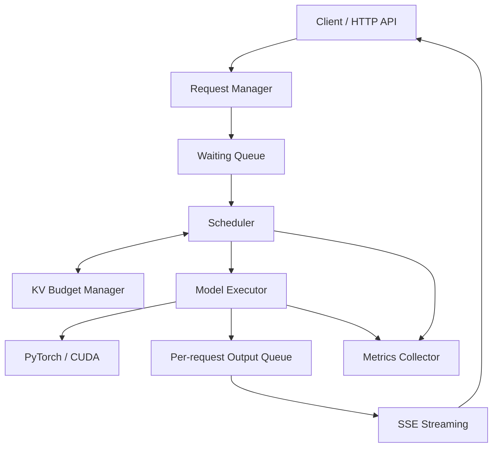

# MiniServe：单 GPU LLM Inference Serving 实现方案

> **版本**：v1.0 · 2026-11  
> **定位**：独立 AI Infrastructure / ML Systems 工程项目  
> **原始状态**：本计划编写时处于设计阶段，尚无代码、运行结果或 Benchmark 数据。  
> **实施进度（2026-11-24）**：用户上传的 Phase 1 V100 结果已通过 6 组 correctness 比较和 15 组 baseline 输出对照。为缩短周期，现已实现 FIFO、每轮一次 prefill、真正的共享 decode forward、逻辑 KV admission、HTTP/SSE 与实验脚本；删减 static batching、调度策略对比等扩展。新功能通过本地微型模型及 HTTP 测试，真实 Qwen/V100 batching 验收仍待运行。最新范围见 [实施状态](docs/IMPLEMENTATION_STATUS.md)，一键 GPU 验证见 [最终验证指南](docs/FINAL_VALIDATION.md)。下文保留原始完整路线图，不能视为所有原计划已经验收。

## 1. MVP 目标与技术栈

**目标**：在 NVIDIA RTX 4080 Laptop GPU 上运行 Qwen2.5-0.5B-Instruct，自行实现请求调度、真正的 token-level continuous batching、KV-cache-aware admission control 与性能测量，并与 Hugging Face 推理基线比较。

| 项目 | 第一版方案 |
| --- | --- |
| Model | `Qwen/Qwen2.5-0.5B-Instruct` |
| GPU | NVIDIA RTX 4080 Laptop GPU |
| 开发环境 | Python 3.11；Windows 11 + WSL2 Ubuntu（推荐）|
| Model execution | PyTorch CUDA + Hugging Face Transformers `4.57.1` |
| Precision / decoding | FP16；greedy decoding |
| HTTP server | FastAPI + Server-Sent Events (SSE) |
| 并发模型 | Request queue + dedicated GPU inference worker |
| 核心能力 | Manual prefill/decode、continuous batching、KV cache admission |
| 性能指标 | Throughput、TTFT、TPOT、P95 latency、GPU memory、queueing time |

第一版**不做**：自定义 CUDA kernel、PagedAttention、prefix caching、CPU offloading、NCCL/multi-GPU 和生产级鉴权。

### 1.1 系统架构



所有模型 `forward()` 均由**单独的 GPU worker** 控制；HTTP handlers 不直接修改模型执行状态。

### 1.2 推荐项目目录

```text
miniserve/
├── src/
│   └── miniserve/
│       ├── __init__.py
│       ├── config.py              # 模型、设备与运行限制
│       ├── api.py                 # HTTP endpoints / SSE
│       ├── request.py             # Request lifecycle
│       ├── scheduler.py           # Waiting/running queues, policies
│       ├── engine.py              # GPU worker loop
│       ├── kv_manager.py          # Memory reservation / admission
│       ├── cache_adapter.py       # Pack/unpack batched KV cache
│       ├── metrics.py             # Timing / counters
│       └── backends/
│           ├── __init__.py
│           └── hf_backend.py
├── benchmarks/
│   ├── hf_baseline.py             # Hugging Face generate()
│   ├── load_test.py               # Concurrent workloads
│   └── compare.py                 # Benchmark summary
├── tests/
│   ├── test_model.py
│   ├── test_cache.py
│   ├── test_scheduler.py
│   ├── test_streaming.py
│   └── test_concurrency.py
├── results/
├── requirements.txt
├── README.md
└── .gitignore
```

---

## 2. Phase 1 — 基础推理引擎

**目标**：先在 GPU 上完成自定义 autoregressive generation loop，不引入 HTTP、并发或调度。  
**预计**：1–2 天。

### 2.1 环境与模型

1. 在目标机器上安装适配驱动/CUDA 的 PyTorch，确认 `torch.cuda.is_available()` 为 `True`。
2. 打印 GPU 名称、总显存、PyTorch 版本，并记录实验环境。
3. 加载 `Qwen/Qwen2.5-0.5B-Instruct`；设置 `model.eval()`、FP16、`torch.inference_mode()`。
4. 固定 tokenizer、chat template 和 EOS 规则。
5. 用 `model.generate()` 完成正常推理，保存为 baseline。

基本检查：

```python
import torch

print(torch.__version__)
print(torch.cuda.is_available())
print(torch.cuda.get_device_name(0))
print(torch.cuda.get_device_properties(0).total_memory)
```

### 2.2 手动实现 prefill / decode

在 `hf_backend.py` 中设计：

```python
def prefill(input_ids):
    """Run prompt forward; return logits and KV cache."""
    ...

def decode(next_token, past_key_values):
    """Run one autoregressive step with cached states."""
    ...
```

概念性生成循环：

```python
logits, cache = prefill(prompt_ids)
next_token = logits[:, -1, :].argmax(dim=-1)
emit(next_token)  # first generated token

while not finished:
    logits, cache = decode(next_token, cache)
    next_token = logits[:, -1, :].argmax(dim=-1)
    emit(next_token)
```

> **关键注意**：Prefill 返回的 KV cache 只包含已经送入模型的 prompt。Prefill logits 产生的**第一枚输出 token 尚未写入 cache**，需要在下一次 decode 时作为输入。还要正确维护 `attention_mask`、`position_ids` 和 EOS/长度边界。

### 2.3 验收标准

- 英文和中文 prompt 的 **greedy token IDs 与 Hugging Face `generate()` 一致**。
- 测试不同 prompt 长度、EOS 提前结束和 `max_new_tokens` 限制。
- 记录单请求生成时间与 CUDA peak memory。
- 给出可重复运行的 baseline 命令和测试结果。

---

## 3. Phase 2 — HTTP API 与 Token Streaming

**目标**：让多个客户端可以连接 MiniServe；现阶段内部 GPU 推理仍可串行。  
**预计**：1 天。

### 3.1 API 设计

| Endpoint | Method | 用途 |
| --- | --- | --- |
| `/health` | GET | 健康检查与模型加载状态 |
| `/v1/generate` | POST | 一次性返回完整生成结果 |
| `/v1/generate/stream` | POST | SSE 逐 token 输出 |
| `/metrics` | GET | 队列、延迟、请求数、显存等指标 |

请求示例：

```http
POST /v1/generate/stream
Content-Type: application/json

{
  "prompt": "Explain continuous batching.",
  "max_new_tokens": 64,
  "temperature": 0
}
```

SSE 数据示例：

```text
data: {"type":"token","text":"Hello"}

data: {"type":"token","text":" world"}

data: {"type":"done"}
```

### 3.2 线程与生命周期

1. HTTP handler 验证请求并将其放入 waiting queue。
2. Dedicated worker 从队列中获取任务并执行模型 `forward()`。
3. 每个 request 独立保存 output queue。
4. SSE handler 从对应 output queue 持续推送事件。
5. 客户端断连时标记取消，worker 及时停止与清理。

**验收**：四个客户端同时建立 streaming 连接，输出互不混淆；断连请求不会持续占用运行状态。

---

## 4. Phase 3 — Request Lifecycle 与 Scheduler

**目标**：自定义管理 waiting/running 请求、状态迁移与取消。  
**预计**：1–2 天。

### 4.1 请求状态

```python
from enum import Enum

class RequestStatus(Enum):
    WAITING = "waiting"
    PREFILL = "prefill"
    DECODING = "decoding"
    FINISHED = "finished"
    CANCELLED = "cancelled"
```

每个 `RequestState` 至少记录：

- `request_id`、`prompt_ids`、`max_new_tokens`；
- `status`、`generated_ids`；
- `past_key_values`、`next_token_id`；
- `output_queue` 与取消标记；
- `arrival_time`、`prefill_start_time`、`first_token_time`、`finish_time`。

### 4.2 Scheduler 接口

```python
class Scheduler:
    def add_request(self, request): ...
    def schedule(self): ...
    def finish_request(self, request_id): ...
    def cancel_request(self, request_id): ...
```

第一版采用 FIFO waiting queue 和 running set，所有执行状态由 GPU worker 统一维护。

初始参数：

```python
MAX_BATCH_SIZE = 8
MAX_QUEUE_SIZE = 64
```

超过队列容量时立即返回明确拒绝响应。

**验收**：请求可排队、运行、完成、取消；完成请求释放状态和预留资源；空队列不会 CPU 忙循环；所有状态迁移有自动化测试。

---

## 5. Phase 4 — 真正的 Continuous Batching

**目标**：多个请求共享一次 GPU decode forward，并允许请求在其他请求仍在执行时动态加入/退出。  
**预计**：3–5 天或更久。

> **定义边界**：`for request in running_requests: model(...)` 仍然是串行推理，**不等于 GPU batching**。真正的 decode batching 应当让一次模型 `forward()` 处理 `batch_size > 1` 个请求，且 batch membership 能按 iteration 变化。

### 5.1 难点：不同请求的 KV cache 长度不一致

例如：

| 请求 | Prompt tokens | 已生成 tokens | KV cache 长度 |
| --- | ---: | ---: | --- |
| A | 128 | 20 | 不同于 B |
| B | 256 | 5 | 不同于 A |

每层 K/V 张量一般形如：

```text
[batch_size, num_key_value_heads, sequence_length, head_dim]
```

当 `sequence_length` 不同时，不能简单沿 batch dimension 直接拼接。

### 5.2 MVP：Padded KV Batching

1. 每个 request 独立保留有效 KV cache，并记录真实 cache length。
2. Scheduler 选出本轮 decode 的请求，取得最长 cache length。
3. 将较短缓存补 padding（可先尝试 left-padding），同时构建正确的 attention mask、position IDs。
4. 将各层 K/V 拼成 batched cache；输入形状为 `[batch_size, 1]` 的 next-token IDs。
5. 执行**一次模型 forward**。
6. 将结果按请求拆分，只保存有效历史和最新 token 的 K/V，丢弃 padding。
7. 完成请求退出；新请求经过 prefill 后可加入下一轮 decode。

```python
def pack_kv_caches(requests):
    """Return batched_cache, attention_mask, position_ids."""
    ...

def unpack_kv_caches(batched_cache, requests):
    """Restore valid per-request cache states."""
    ...
```

动态成员示例：

```text
Iteration 1: [A, B]
Iteration 2: [A, B, C]
Iteration 3: [A, C]
Iteration 4: [A, C, D]
```

### 5.3 风险与验证

- Padding 不仅影响 tensor shape，也影响 causal attention mask、RoPE `position_ids` 和 `cache_position`。
- 必须逐 token 比较 batched decode 和单请求 greedy decode 的结果。
- 每次 decode 都重新拼装 KV cache 会带来显存拷贝开销，**第一版不一定比 baseline 快**。
- 若确认瓶颈在 cache copying，后续才考虑 static allocation 或 paged KV cache。

**验收**：

- 两个及以上请求实际共享一次模型 forward。
- 不同 prompt length 的输出分别与单请求版本一致。
- 晚到请求可以加入，完成请求可以退出。
- 没有跨请求 KV cache 污染。

---

## 6. Phase 5 — KV-cache-aware Admission Control

**目标**：在有限 memory budget 下决定哪些请求进入 running set，并正确释放资源。  
**预计**：1–2 天。

### 6.1 KV cache 大小估算

理论 KV cache bytes per token：

```python
kv_bytes_per_token = (
    2 * num_hidden_layers
      * num_key_value_heads
      * head_dim
      * bytes_per_element
)

request_reservation = kv_bytes_per_token * (
    prompt_len + max_new_tokens
)
```

对 Qwen2.5-0.5B-Instruct（24 层、2 KV heads、head_dim=64、FP16），KV cache 理论上约 **12 KiB/token**。该值不包含模型权重、activations、padding 或 CUDA 临时分配。

### 6.2 Admission Policy

| 情况 | 初始策略 |
| --- | --- |
| 可用 KV budget 足够 | Admit，预留最大 token budget |
| 暂时容量不足 | 放入 waiting queue，之后重试 |
| 单个请求超出总预算 | 直接拒绝，不无限等待 |
| Active request 结束/取消 | 清理 KV cache 并释放 reservation |

初始版本选择 **Queue, not Preempt**：不抢占已有请求，不随意清除 active KV cache。这样有助于保证正确性和执行可预测性，代价是新请求的 TTFT 可能增加。需要设置最大队列长度和超时。

### 6.3 可控的资源实验

0.5B 模型 KV cache 较小，短 prompt 未必触发真实显存不足。建议使用：

```python
KV_BUDGET_MB = 48  # configurable logical KV budget
```

在 8/16 并发下观察 admission 和排队行为。

**务必说明**：48 MiB 是人为设置的软件测试上限，不代表 GPU 的实际可用显存。理论 KV 预算也不能完全防止临时 CUDA allocations 引发真实 OOM。

**验收**：reservation 不为负、不重复释放；等待请求在容量释放后可以进入；记录 queueing time 和 rejection 原因。

---

## 7. Phase 6 — Benchmark 与可复现实验

**目标**：测量真实结果，最终用于 README、简历与 SOP。  
**预计**：1–2 天。

### 7.1 对照组

1. **HF Sequential**：同一模型使用 `model.generate()` 串行处理请求。
2. **HF Static Batching（可选）**：固定请求集合的静态 batch。
3. **MiniServe**：自己实现的 dynamic continuous batching。

不能仅仅通过超过串行 HF，就声称调度策略优于现有 serving 系统。

### 7.2 统一实验条件

| Parameter | Value |
| --- | --- |
| Model / GPU / precision | 相同 |
| Input length | 128 / 256 tokens |
| Max output length | 64 tokens |
| Concurrency | 1 / 4 / 8 / 16 |
| Arrival pattern | Burst + staggered arrivals |
| Repetitions | Warm-up 后至少 5 次 |
| Decoding | Greedy；相同 EOS/长度规则 |
| Metrics | tokens/s、P50/P95 TTFT、TPOT、P95 latency、peak VRAM、queue time |

### 7.3 三组实验

**Experiment A — Continuous Batching**

- 比较 sequential / static / continuous batching 的 throughput、TTFT、TPOT。
- 同时报告收益和可能增加的等待/调度开销。

**Experiment B — Memory-Aware Admission**

- 比较不同逻辑 KV budgets 对 queue time、P95 TTFT、peak GPU memory 和请求完成率的影响。

**Experiment C — Scheduling Policy（可选）**

- 比较 FIFO、decode-priority、periodic prefill。
- 研究活跃请求的流式输出速度与新请求首 token 延迟之间的取舍。

### 7.4 指标与计时

- **Throughput**：total generated output tokens / wall-clock elapsed seconds。
- **TTFT**：客户端发送请求到收到第一枚输出 token 的时间。
- **TPOT**：首 token 之后后续 token 之间的平均间隔。
- **Queueing time**：arrival 到 admission/prefill start 的等待时间。
- **GPU execution**：使用 CUDA Events 或必要的 CUDA synchronization 测量；不能用异步 kernel launch 的 CPU 时间替代。

结果建议输出 JSON，保留原始记录与环境信息，不预设任何性能提升百分比。

---

## 8. GitHub Issues 与优先级

| Issue | 工作内容 | 优先级 | 完成定义 |
| --- | --- | --- | --- |
| #1 | HF model + baseline | P0 | GPU 推理正常，保存 baseline |
| #2 | Manual prefill/decode | P0 | Greedy token IDs 与 HF 一致 |
| #3 | FastAPI + SSE | P0 | 流式输出与取消正确 |
| #4 | Request lifecycle + FIFO | P0 | 排队、完成、取消状态正确 |
| #5 | Batched KV cache adapter | P0 | 不同长度 KV 可正确合批 |
| #6 | True continuous batching | P0 | 动态进出，decode forward batch size > 1 |
| #7 | KV-aware admission | P1 | 预算、排队、释放正确 |
| #8 | Metrics instrumentation | P1 | TTFT、TPOT、VRAM 等指标齐全 |
| #9 | Benchmark suite | P1 | 重复实验，保存原始结果 |
| #10 | Scheduling comparison | P2 | 调度策略对比和取舍分析 |

**建议顺序**：`#1 → #2 → #3 → #4 → #5 → #6 → #7 → #8 → #9`；#10 作为可选扩展。

### 8.1 里程碑

| Milestone | 验收目标 |
| --- | --- |
| M1 — Correctness | 自定义 generation loop 复现 HF greedy outputs |
| M2 — Serving | HTTP + SSE 支持多客户端，生命周期正确 |
| M3 — True Batching | 动态 request membership + shared GPU batched forward |
| M4 — Resource Control | KV-aware admission、排队及取消行为可验证 |
| M5 — Evaluation | 真实 workload、原始数据、对比图表和 tradeoff 分析 |

### 8.2 最低测试矩阵

- **Correctness**：英文/中文、相同/不同 prompt lengths、EOS、最大输出长度、并发输出不污染。
- **Scheduling**：晚到请求加入、完成退出、队列上限、取消、不忙等。
- **Memory**：reservation 正确增减、逻辑预算生效、peak VRAM 有记录。
- **Performance**：相同 workload 与硬件、多次重复、吞吐量和延迟同时报告。

---

## 9. 第一次编码 Session：从这里开始

1. 建立 Git repository 和 Python 3.11 虚拟环境。
2. 使用 [PyTorch 官方安装页面](https://pytorch.org/get-started/locally/) 选择适合当前 GPU/CUDA 的安装命令。
3. 安装固定版本的 Transformers、FastAPI、pytest 等。
4. 编写 `benchmarks/hf_baseline.py`：固定 prompt，生成最多 64 tokens，记录 token IDs、时间与显存。
5. 编写 `src/miniserve/backends/hf_backend.py`：手动 `prefill()` / `decode()`。
6. 编写 `tests/test_model.py`：至少三个 prompt 的逐 token 对照测试。
7. 首次 commit **只提交可运行的基础推理与单测**，不提前加入 Scheduler 或 Batching。

```bash
python -m venv .venv

# 激活虚拟环境，并先按 PyTorch 官网指引安装匹配的 PyTorch
pip install "transformers==4.57.1" fastapi uvicorn pytest httpx

python -c "import torch; print(torch.cuda.is_available())"
pytest -q tests/test_model.py
```

**第一阶段交付物**：一个可重复运行的 HF baseline、一个自定义 generation loop、正确性测试、GPU/软件版本信息。**此时不要在 README、SOP 或简历中写入尚未测量的性能数字。**

---

## 10. 后续可用于 SOP 的研究问题

1. *How much does continuous batching change aggregate throughput under concurrent workloads?*
2. *How should a scheduler admit requests when KV-cache capacity is constrained?*
3. *What tradeoffs arise between TTFT, TPOT, and throughput when scheduling prefill and decode?*

最终要展示的不只是一个 LLM API server，而是**从问题定义、系统设计、正确性验证到可复现性能实验**的完整工程过程。

## 11. 官方参考资料

- [Qwen2.5-0.5B-Instruct Model Card](https://huggingface.co/Qwen/Qwen2.5-0.5B-Instruct)
- [Hugging Face KV Cache Explanation (Transformers v4.57.1)](https://huggingface.co/docs/transformers/v4.57.1/cache_explanation)
- [FastAPI StreamingResponse](https://fastapi.tiangolo.com/advanced/custom-response/)
- [PyTorch CUDA Semantics and Timing](https://docs.pytorch.org/docs/stable/notes/cuda)
