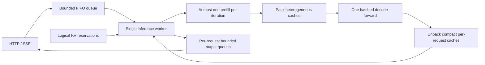

# MiniServe

MiniServe is a single-GPU inference systems project for `Qwen/Qwen2.5-0.5B-Instruct`. It implements manual autoregressive generation, **real token-level continuous batching**, FIFO scheduling, logical KV-budget admission, and an HTTP/SSE interface. Local CUDA GPUs and allocated Great Lakes GPU nodes use the same code.

The scope has been shortened to finish one complete systems experiment: **how dynamic batching and a logical KV budget change throughput, queueing, and streaming latency**. Static batching, scheduler-policy comparisons, multi-GPU execution, PagedAttention, prefix caching, and production authentication are deferred.



## Verified evidence

The uploaded Phase 1 run used a **Tesla V100-PCIE-16GB, PyTorch 2.6.0+cu124, Transformers 4.57.1, FP16**. All six greedy comparisons passed; all 15 HF/manual benchmark input and output token-ID sequences also match. Each benchmark produced 860 tokens.

| Phase 1 execution | Generated tokens/s | P95 generation seconds |
| --- | ---: | ---: |
| HF sequential | 30.5674 | 2.0959 |
| Manual sequential | 31.1452 | 2.0568 |

The original JSON files are preserved in [evidence/phase1_v100](evidence/phase1_v100). These are single-request baselines, not continuous-batching results. Their throughput denominator is summed generation time; the new serving experiment uses entire workload wall time and must not be compared directly to this table.

Local validation: **84 tests passed, 8 pretrained-model tests skipped**. The complete script also passed with a saved synthetic checkpoint, including eight successful real HTTP/SSE requests and an observed decode batch size of eight. **Real Qwen/V100 acceptance and serving measurements for the new code remain to be run on the cluster.** No GPU batching speedup is claimed yet.

## Run tonight

Follow [the final validation guide](docs/FINAL_VALIDATION.md) for the Great Lakes commands. After updating dependencies and preparing the existing model cache, run inside an allocated GPU session:

```bash
cd /home/zywangg/miniserver
source .venv/bin/activate
export HF_HOME="$PWD/.cache/huggingface"

# Short correctness + experiment + real HTTP/SSE smoke run.
bash scripts/run_final.sh --quick

# Full controlled experiment: 5 repetitions, burst/staggered, 1/4/8 requests,
# mixed 128/256-token inputs, up to 64 outputs, 8/48 MiB logical KV budgets.
bash scripts/run_final.sh
```

Both scripts fail on test failures, output mismatches, or failed HTTP requests. They write raw JSON, JUnit XML, dependency versions, a comparison CSV, and server logs into a unique `results/final-*/` directory. `--quick` is a smoke test, not publishable performance evidence.

## Install and develop

Python 3.11 is recommended (supported: 3.11–3.13). Install a PyTorch CUDA wheel matching the server; the existing V100 run used 2.6.0+cu124. Then:

```bash
python -m pip install -r requirements.txt
python -m pip install -e . --no-deps
python -m pytest -q
```

Default tests use a randomly initialized tiny Qwen2 on CPU, with no model download. Enable the real pretrained tests on a GPU with:

```bash
MINISERVE_RUN_MODEL_TESTS=1 python -m pytest -q
```

The default model and tokenizer revision are pinned to `7ae557604adf67be50417f59c2c2f167def9a775`. All generation paths use pure greedy decoding, the same EOS list, and explicit HF default overrides. Other full-attention Qwen2/Qwen2.5 checkpoints can be selected using `--model` and `--revision`; new architectures require validation.

## Serve

```bash
python -m miniserve --device cuda:0 --dtype float16 --local-files-only \
  --max-batch-size 8 --kv-budget-mb 48 --port 8000
```

Use one server process per GPU. The default bind address is loopback; no authentication is implemented. The server respects `CUDA_VISIBLE_DEVICES` and never silently falls back to CPU. For CPU development, explicitly pass `--device cpu --dtype float32`.

```bash
curl http://127.0.0.1:8000/health
curl http://127.0.0.1:8000/metrics
curl -N http://127.0.0.1:8000/v1/generate/stream \
  -H 'Content-Type: application/json' \
  -d '{"prompt":"Explain KV caches.","max_new_tokens":32,"temperature":0}'
```

`POST /v1/generate` accepts the same body and returns one complete JSON result. Streaming emits one `token` event per output ID, then `done` or `error`. Some token events have empty text while an incomplete Unicode sequence is buffered. Terminal `text` and `output_ids` are authoritative. Disconnects mark requests for cancellation; cancellation is applied at the next iteration boundary.

Oversized requests are rejected with 413, queue overflow with 429, and unavailable workers with 503. Non-streaming queue timeouts return 408; after SSE headers have been sent, failures are terminal SSE events. Request lifecycle, queue depth, budget usage, bounded decode membership traces, batch-size histograms, and recent latency percentiles are available through `/metrics`.

## Experiments and limits

```bash
# In-process comparison against HF, including exact token-ID validation.
python -m benchmarks.serving_eval --local-files-only --output results/evaluation.json
python -m benchmarks.compare results/evaluation.json --output results/comparison.json

# Client-observed timing against a running server.
python -m benchmarks.load_test --concurrency 8 --repetitions 5 \
  --output results/http_load.json
```

The engine benchmark precomputes HF reference outputs and checks every measured output against them. It alternates execution order, warms each configuration, preserves each request, and reports failed requests. HF TTFT/TPOT are left null because the baseline returns its output at completion. The HTTP client separately measures first-token arrival, subsequent-token intervals, latency, and failures. Comparison CSV latency columns are means of per-run percentiles, not pooled percentiles.

The KV budget reserves theoretical compact cache bytes for `prompt + max_new_tokens`. **It excludes weights, activations, padded batch storage, and temporary copies; it cannot guarantee avoidance of physical CUDA OOM.** Every decode repacks and clones caches, so copy overhead can make this implementation slower than HF. Strict FIFO can cause head-of-line blocking. One unchunked prefill runs before each decode iteration, so long prompts can interrupt active streams. These are explicit design tradeoffs to measure.

Detailed design and acceptance boundaries: [shortened implementation scope](docs/IMPLEMENTATION_STATUS.md). Original roadmap: [Chinese blueprint](MiniServe_Implementation_Blueprint_CN.md). Original Phase 1 instructions: [GPU validation](docs/GPU_VALIDATION_CN.md).
